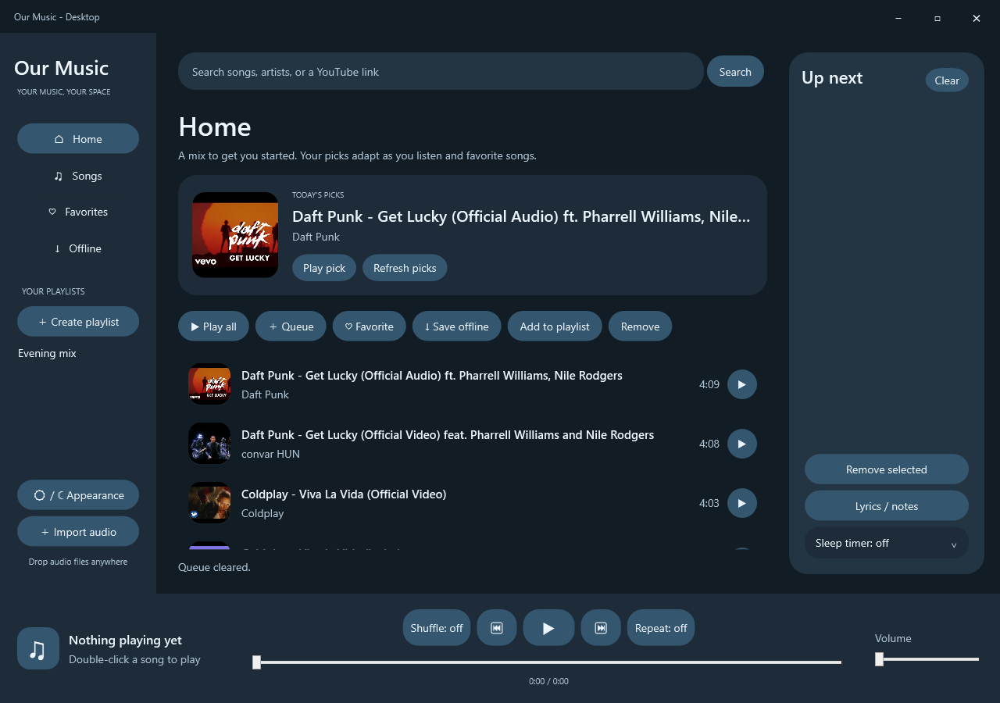

# Our Music - Desktop

A Windows music player built in C# and WPF. Search YouTube, listen to local files, and keep your queue, playlists, and favorites in one place.



## Features

- Light and dark themes, matching window colors, and animated page changes.
- Cover artwork in the song list, Home banner, and player, cached for later use.
- Home recommendations based on listening history and favorites.
- YouTube search and playlist links, alongside local audio imports.
- Playback queue, shuffle, repeat, volume control, seeking, and a sleep timer.
- Offline audio downloads and editable lyrics or notes.
- Saved playlists, favorites, queue, and preferences across restarts.

## Getting started

Download the Windows x64 ZIP from [Releases](https://github.com/unreliablecode/our-music-desktop/releases/latest), extract it, and open `OurMusic.Desktop.exe`. Keep the extracted files together. No .NET installation is needed for the packaged release.

The app runs on Windows 10 or 11, x64. Online playback uses [yt-dlp](https://github.com/yt-dlp/yt-dlp) and requires [Node.js](https://nodejs.org/) on PATH for YouTube's JavaScript challenges. Development requires the [.NET 10 SDK](https://dotnet.microsoft.com/download/dotnet/10.0).

From PowerShell in the repository root:

```powershell
./Setup.ps1
./Run.ps1
```

To create a self-contained build:

```powershell
./Publish.ps1
```

Open `publish/OurMusic.Desktop.exe`. Keep the whole publish folder together; the executable relies on the files beside it. This build includes the .NET runtime and yt-dlp. Node.js remains a separate installation. Local playback works without an internet connection.

If YouTube playback stops working after a service change, run `Setup.ps1` again and rebuild. The script downloads yt-dlp from its official release page.

## Using the player

Home shows a starter mix on first launch, then refreshes it in the background. Each song has its own play button in search results, Home, library pages, playlists, and the queue. Click it to start that song immediately. Double-clicking a row also works; Play all starts the displayed list from the beginning. Select a song before adding it to the queue, marking it as a favorite, saving it offline, or choosing a playlist.

Paste a YouTube or YouTube Music playlist URL into the search box to load its first 50 entries. Text searches return up to 20 results. Import audio with the sidebar button, or drag files into the window. Supported extensions are MP3, M4A, WAV, WMA, AAC, and MP4; playback depends on the codecs available in Windows.

The song list scrolls with the mouse wheel, touchpad, or keyboard. Scrollbars are hidden to keep the layout uncluttered. Remove deletes playlist membership when viewing a playlist, or the library entry on Songs. It leaves audio files on disk.

## Recommendations

The ranking is deliberately small and local. Favorites carry more weight than individual plays. Repeated listening increases an artist's score, and recent plays add a smaller boost. The app searches for music by the two strongest artists and adds a rotating discovery query.

YouTube's search order supplies the initial candidates. Our Music then applies its own scores, reduces the priority of tracks heard in the last day, removes duplicates and long compilations, and allows at most three tracks per artist. New users see a bundled mix while the first refresh runs.

Results are cached for 12 hours and refreshed when you return to Home after listening history or favorites change. Refresh picks requests an update immediately. If the network is unavailable, saved recommendations remain visible.

This does not use your signed-in YouTube recommendation feed. The app has no account login and does not read browser cookies. History stays on your computer; artist names are sent to YouTube as search queries.

## Storage

Existing installations continue using `%LOCALAPPDATA%/MusicYouDesktop` to preserve their libraries. The folder holds `library.json`, recommendation data, cached artwork, and downloaded audio. Imported files stay in their original locations. If you move one, import it again.

Playback does not resume automatically when the app opens. History records successful playback starts rather than completed listens.

## Development

Application code is in `src/OurMusic.Desktop`. The smoke test runner is in `tests/OurMusic.SmokeTests`.

```powershell
dotnet build src/OurMusic.Desktop -c Release
dotnet run --project tests/OurMusic.SmokeTests -c Release
dotnet run --project tests/OurMusic.SmokeTests -c Release -- --online
```

The default checks cover local playback, saved data, queue behavior, recommendation ranking, and interface settings. The online checks also exercise cover downloads, recommendation refresh, YouTube streaming, and an offline download. Each run uses a separate temporary data folder.

GitHub Actions runs the build and interface checks with `--skip-audio`, because its hosted runner has no usable playback device. Run the default and online checks on a Windows desktop to verify audio.

## Known limits

There is no YouTube sign-in, album or artist browsing, automatic lyric lookup, synchronized lyrics, embedded audio tag extraction, normalization, or silence skipping. Restricted videos may not play, and online availability depends on YouTube and yt-dlp. The main title bar follows the app theme; dialog title colors depend on Windows support.

## License and attribution

Our Music is maintained in an independent repository. Its Windows interface takes inspiration from [Music You by Daniel Sevillano](https://github.com/DanielSevillano/music-you). The original project is licensed under GPL-3.0; this repository keeps that license. See [LICENSE](LICENSE) and [NOTICE](NOTICE).

YouTube and other product names belong to their respective owners. This project is not affiliated with Google or YouTube. yt-dlp and Node.js have their own licenses and are distributed separately from this source repository.
